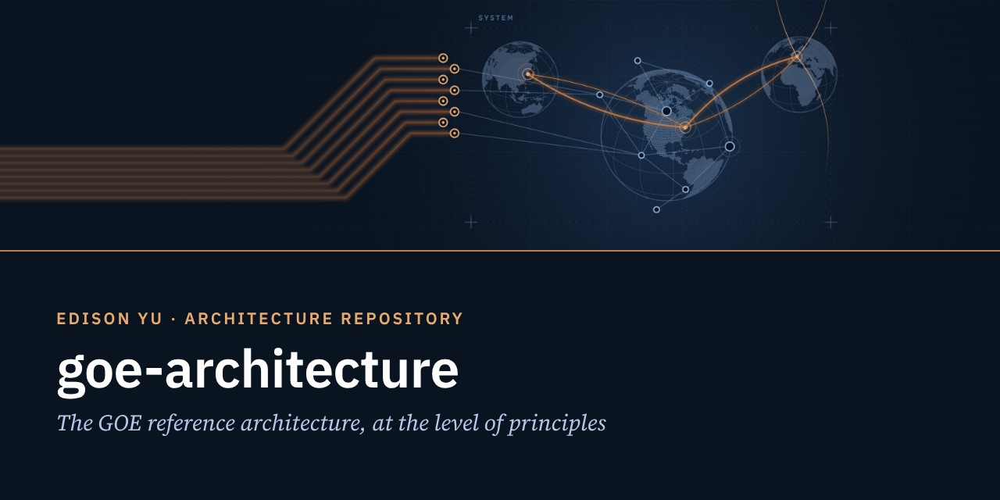
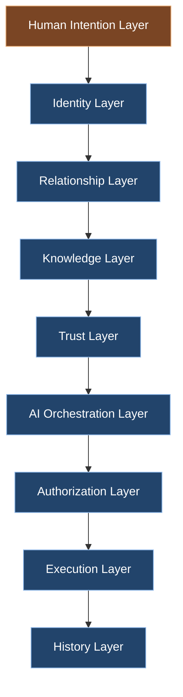
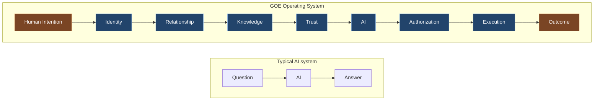

  

# GOE Architecture

**The GOE™ reference architecture, at the level of principles.**
Architecture thinking · Systems thinking · Platform thinking

> GOE is not built around models. GOE is built around people.

---

## Purpose

**Why it exists.** To show how GOE is structured as a system: what it is made of, the order in which its layers act, and where people stay in control.

**What problem it solves.** AI systems are usually designed around a model: a question goes in and an answer comes out. Once AI systems act in the real world, the hard questions become who is asking, on whose behalf, with what trust, and who authorized the action. GOE places those questions in the architecture itself.

**How it fits the ecosystem.** GOE provides the operating framework. This repository is the architectural view of that framework, drawn from the white paper [GOE Operating System™](https://www.yugeniuslab.com/publications/goe-operating-system/) (Revision 1.2, Chapter 10).

## Identity

GOE began as a framework for turning ideas into working systems. Today GOE has evolved into a Human-Centered Operating System built around identity, trust, authorization, human intention, and execution boundaries.

GOE is a Human-Centered Operating System governed by:

**Identity · Trust · Authorization · Human Intention · Constitution · Principles · Execution Boundaries**

## Architecture

### The GOE operating stack

AI is one layer. Trust is one layer. Knowledge is one layer. Identity is one layer.
**Human Intention remains the starting point.**

### Flow: what makes GOE different

### GOE operates above AI platforms

GOE does not compete with AI platforms. GOE operates above AI platforms. AI services, RAG systems, retrieval systems, reasoning models, agents, and future intelligence systems operate within GOE's identity, trust, authorization, and execution framework.

### Human-AI operating model

AI may assist. AI may advise. AI may recommend. AI does not govern.
**Humans authorize. Humans approve. Humans remain accountable.**

### Foundational principle

People express intention. GOE handles complexity. The physical world responds.

## Relationship to GOE

This repository is GOE's architecture at the level of concepts and principles. It defines what the framework is and how its parts relate. It does not describe any implementation.

## Relationship to Yu Genius Lab

Yu Genius Lab publishes knowledge; this is one of its engineering views. The canonical text is the white paper, and the vocabulary follows [Open Knowledge™](https://www.yugeniuslab.com/open-knowledge/).

## Vocabulary

| Term | Definition |
|---|---|
| GOE™ | A Human-Centered Operating System governed by identity, trust, authorization, human intention, constitution, principles, and execution boundaries |
| Human Intention | The starting point of every action in GOE |
| Execution Boundaries | The limits within which any action, by a person or an AI system, may be carried out |
| Human Authorized Execution | Action in the physical or digital world that proceeds only with human authorization |
| GOE Lab™ | The trusted participation layer of the ecosystem |
| GOE Global™ | The expansion of connection to the real world beyond GOE Lab |

## Public disclosure

The publication communicates the philosophy and vision. The implementation remains confidential. Protocols, data structures, interfaces, security architecture, and runtime components are not published here.

## Future Direction

- Principle-level notes for each layer of the operating stack, as the white paper evolves.
- New architecture views when a published revision of GOE Operating System™ introduces them.

## References

- [GOE Operating System™: The Eight-Level Engineering Evolution Framework](https://www.yugeniuslab.com/publications/goe-operating-system/) · [Read online](https://www.yugeniuslab.com/publications/goe-operating-system/white-paper/)
- [GOE Lab™](https://www.yugeniuslab.com/goe-lab/)
- [Open Knowledge™](https://www.yugeniuslab.com/open-knowledge/)
- Companion repositories: [goe-operating-system](https://github.com/ilsooedisonyu/goe-operating-system) · [open-knowledge](https://github.com/ilsooedisonyu/open-knowledge)

---

© 2026 Edison Yu. All rights reserved. You may read, link to, and quote short excerpts with attribution. · Engineering Repository™ · Revision 2026.70
